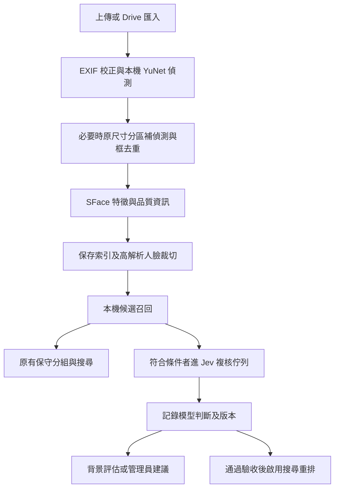

# 人臉偵測與同人比對調整方案

> 本文件保留作為早期 Jev 方案參考。目前執行方向以 [本機人臉偵測與同人比對改善計畫](face-recognition-improvement-plan.md) 為準：第一版先改善本機偵測、配對及人工校正，暫不加入通用決策模型。

規劃日期：2026-10-21。狀態：設計提案，尚未串接 Jev、傳送照片或修改現有人物資料。

## 建議方向

保留 YuNet／SFace 作為本機人臉偵測與候選召回核心，加入 Jev 做圖片品質判讀與疑難配對複核。先驗證成效，再開啟管理建議及搜尋重排；人物自動歸組最後才評估。

Jev 官方已提供圖片及同人圖片比較的使用範例，但圖片與 Box 仍標示為實驗功能，沒有可直接套用到本專案的婚禮人臉準確率證據。因此「有支援」與「能提高本專案準確率」分別驗證。[官方 Images](https://docs.typesafe.ai/images)

## 目前程式與主要限制

| 範圍 | 現況 | 調整重點 |
| --- | --- | --- |
| 偵測／裁切 | `backend/face-service/app.py`：EXIF 校正、整圖縮至最長邊 1600、YuNet 偵測門檻 0.9 | 大合照小臉可能在縮圖時遺失細節；加入原尺寸分區偵測與品質量測 |
| 特徵 | `extract()` 以 SFace 對齊後產生正規化向量 | 第一階段維持同一 embedding 空間，避免重建人物索引 |
| 分組 | `core.py:add_photo()`：與每人樣本取最大 cosine，門檻 0.50、第一二名差距 0.06 | 前五個樣本缺少品質／角度選擇；單一錯誤樣本可能擴散分組錯誤 |
| 同圖限制 | `add_photo()` 的 `used` 限制同張照片兩個觀測歸入同一人物 | 保留；重複偵測框須先去重。拼貼、鏡面與螢幕中的重複人像另交人工處理 |
| 搜尋 | `app.py:find()` 逐照片掃描全部人臉，門檻 0.30 | 先選候選人臉再複核；不應對每張照片呼叫 Jev |
| 頭貼／品質 | 160×160 頭貼；quality 僅面積乘偵測分數 | 新增高解析人臉裁切及清晰度／遮擋等資訊；面積不能代表可辨識程度 |
| 原圖生命週期 | `backend/server.js:cleanupOriginals()` 在雲端確認及索引落盤後清除原圖 | 新分析先保存必要裁切；舊照片補做時需受控讀回 Drive |
| 管理／併發 | 人工合併及最近一次復原；單一 Node、Python worker；模型與狀態鎖 | Jev 不持有現有鎖等待網路；回寫前重新核對人物版本 |

## Jev 能力與整合約束

- 部署限制（2026-10-21 查核）：官方企業 FAQ 明確表示 Jev 目前僅透過託管 API 提供，不支援自有 VPC 或 on-premises。將 SDK 安裝在本機仍是呼叫遠端模型，不能作為離線推論方案；本規劃的 Jev 階段均需連網。若要求人臉分析完全在本機進行，保留 P0／P1 與人工管理流程，停用 Jev，另行評估可本機部署的人臉專用模型。[官方企業 FAQ](https://typesafe.ai/enterprise)
- 原型固定使用 `jev-1.14.0`，同時記錄實際回應模型。此版本支援 Box；帳號可用性實作時以 `/v1/models` 核對。避免使用會移動的 alias 來調門檻。[官方 Models](https://docs.typesafe.ai/models)
- 從 Python 後端透過官方 `typesafe-sdk` 呼叫 `POST /v1/systemone`，API key 只放後端；圖片請求必須附 `TypeSafe-Danger-Zone-Images: true`。[Python SDK](https://docs.typesafe.ai/sdk/python)、[API](https://docs.typesafe.ai/api/system-one)
- 影像先轉 JPEG／PNG，雙邊尺寸須在 280–1568 範圍。現有 160 頭貼不可直接送出；1600 預覽也須另行處理。優先從原圖另存 384–512 像素人臉裁切，保留原始人臉像素尺寸；放大只解決格式，不增加辨識資訊。[官方 Images](https://docs.typesafe.ai/images)
- 同人判斷用 `Choice(same, different, insufficient)`，品質判讀獨立提問；`confidence` 表示分布集中程度，不是已驗證的正確率。若比較 Noul 方案，它只有 `noul` 值，不應讀取不存在的 confidence。[官方 Confidence](https://docs.typesafe.ai/confidence)
- 不將原始 embedding 數字交給 Jev 猜身份，不讓它代算 cosine 或門檻。[官方已知限制](https://docs.typesafe.ai/model-jaggedness/jev-1.13)

## 預定流程

### 1. 找人臉：先改善本機召回

1. 保留目前快速整圖偵測，再提供可設定的分區補偵測模式。從 EXIF 校正後的原尺寸影像裁重疊區塊，不把已縮小的預覽放大來偵測。
2. 將區塊中的框與五官位置轉回共同座標，依框重疊及位置去重，再對每個觀測產生一份特徵；記錄原圖尺寸與座標轉換版本。
3. 儲存 face ID、偵測分數、原始臉寬高、清晰度、來源區塊與裁切版本。為裁切大小及解碼像素設上限，避免高解析照片拖垮單 worker。
4. 同時計量耗時與小臉召回。降低 YuNet 門檻、分區策略、Jev 品質過濾分別評估，避免混在一起而無法判斷改善來源。
5. Jev 可針對疑似誤偵測的裁切評估「是否可辨識的人臉／是否足夠清楚」，初期只做標註。YuNet 完全漏掉的臉不會靠配對複核找回。

Box 只列為後續漏臉原型：它一次回傳一個框、沒有「未找到」回傳值，也沒有 SFace 對齊需要的五官位置。必須搭配存在性判斷、區域切分及本機五官定位驗證；不能直接當多人偵測器替換 YuNet。[官方 Box](https://docs.typesafe.ai/primitives/box)

### 2. 比較同人：候選召回後才呼叫 Jev

- 候選以人物為單位，初始 Top-K=3，每人最多兩張不同角度且品質合格的代表裁切；自拍搜尋先取 Top-20 人臉並按照片去重。這些是起始實驗參數。
- 觸發條件涵蓋相似度邊界、第一二名接近、品質偏低、疑似重複人物。候選下限由標註資料決定，不能直接沿用搜尋 0.30 當成已校準的複核範圍。
- 每對裁切問一個同人 Choice；品質另問一題，程式合併結果。問題明確要求依臉部細節判斷，衣服／背景相同不能單獨作為同人證據。
- 第一階段 Jev 不改寫自動歸組。`same` 只形成建議，`different` 只形成衝突提示，`insufficient` 保留未決；不改變現有門檻。
- 後續若實驗顯示單一最大樣本分數易誤配，再比較品質與角度多樣的代表集、多人樣本一致性評分。每種策略獨立做消融比較。
- 若未來開放自動歸組，必須同時通過本機最低分、候選差距、影像品質、Jev 結果與校準門檻，並驗證其他候選無衝突。同張照片一對一限制及人工排除紀錄優先。

### 3. 管理頁：先交付可確認的建議

新增「可能是同一人」列表，顯示兩側數張樣本、相關相簿及資料不足提示。提供「合併」「不同人」「略過」。不把模型 confidence 顯示成「本人機率」。

合併仍走既有 `/api/admin/merge` 及 `/api/admin/undo`。另存建議狀態與人工不同人紀錄，綁定穩定 face ID 及人物 revision；合併、復原、新樣本或代表圖變更後重算／失效，不能沿用舊建議強制回寫。人工確認合併仍可處理鏡面等特殊照片。

### 4. 自拍搜尋：先保留相容性，再驗證重排

先以 shadow 模式評估 Jev，對賓客仍回傳原有 `matches[{id,name,score,url}]`。`score` 保持 cosine 語意；新增的 decision、confidence 如要公開，另設有明確名稱的欄位。

正式重排只處理有限候選，保留未複核結果與本機排序作為回退；不因沒送 Jev、逾時或 `insufficient` 就刪掉照片。重排後的順序與舊 API「依 score 降冪」約定不同，須同步更新 `API.md`，可新增 `rankingMode` 說明來源。

## 資料、佇列與原圖處理

- `face_index.json` 維持 Python 單一寫入者；新增穩定 face ID、模型／預處理版本與可選品質欄位，舊資料缺欄位時可讀。face ID 一經建立就保存，不依下一次偵測順序重編。
- 新增不公開的 `DATA_DIR/face_crops/`、`face_review_jobs/`、`face_reviews.json`，由 Python 管理；公開 `/thumbs` 仍只有展示頭貼。既有索引、人物 ID、aliases、merge_history 完整保留。
- 分析時先原子保存裁切及 metadata，再提交索引。Jev 待辦不阻擋原圖正常清理；裁切遺失可重建或標為 unavailable，不能反覆令照片分析失敗。
- Jev 背景 worker 起始併發 1，與本機分析分開；不得持有 `model_lock` 或 `state_lock` 等網路。讀快照 → 呼叫 → 核對 revision → 落盤；版本改變則丟棄或重新排隊。
- 建議增加持久化複核 job，去重鍵包含兩側 crop hash、模型、問題模板及預處理版本。記錄狀態、重試時間、來源與人工處置，避免重啟後重複大量呼叫。
- 舊索引先補 face ID；從既有預覽取得裁切僅在原始像素足夠時使用。缺細節才由 Node 依既有 Drive 權限受控讀回，送 Python 的獨立補做任務；不重跑一般 importer，不重設 `originalReleased`，完成後清除暫存。
- 舊人物代表樣本無法對應裁切時，由既有照片觀測選代表；不從 embedding 還原圖片。重偵測若框對不上，交人工核對，避免錯接人物。
- 回填只補 metadata／裁切及建議，不刪索引、不重新編人物 ID、不自動改寫歷史分組。若未來更換 SFace，建立獨立版本索引，禁止混算不同模型向量。

## 失敗、成本與資料範圍

預定 `JEV_MODE=off|shadow|review|search`，預設 off；分別控制漏臉實驗及自動歸組，自動歸組第一版不開放。另設 `TYPESAFE_API_KEY`、`JEV_MODEL`、`JEV_TIMEOUT_SECONDS`、`JEV_MAX_CALLS_PER_DAY` 與重試上限；這些名稱是提案，尚非可用設定。

搜尋額外等待預算起始設 3 秒；逾時立即回本機結果，取消剩餘工作。背景任務對 429／暫時性錯誤按 Retry-After 與退避重試，400／422 類格式錯誤不盲重試；連續失敗暫停呼叫。SDK 內建重試也須納入總時間與次數，避免雙重重試超出預算。

只送必要裁切與不透明代號，去除 EXIF，不送姓名、Drive URL、OAuth 憑證或整本相簿；在產品啟用雲端複核前清楚告知照片會交外部模型處理，並提供維持本機分析的選項。自拍雲端複核也需獨立選擇；自拍預設只在請求期間處理，不保存原照或持久化查詢裁切。

以回應 usage 與當期計價計量實際成本，設定呼叫硬上限，記錄 P50／P95 延遲、cache hit、逾時與回退率。不要以文字分類 demo 的速度或 token 成本推估整批婚禮照片。

## 實作分期與檔案

| 階段 | 預計修改 | 完成條件 |
| --- | --- | --- |
| P0：基線 | 新增 `backend/face-service/evaluate_faces.py` 與不入版控的標註資料 | 可重現目前漏臉、誤配、拆組、搜尋召回與延遲 |
| P1：本機改善 | 拆出 `face_engine.py`；調整 `app.py` 與 `core.py` 的可選欄位 | 分區去重、裁切先落盤、舊索引／合併／復原相容 |
| P2：Jev 背景評估 | 新增 `jev_client.py`、`review_worker.py`；更新 Python 依賴、lock 與設定範例 | off 不發請求；shadow 記錄結果但不影響人物及搜尋 |
| P3：管理建議 | 新增 Python 管理端點，經 Node `admin-auth.js` 代理；修改管理頁 JS／HTML | 登入保護、確認／排除／略過、建議失效與復原可驗證 |
| P4：搜尋加強 | 調整 `find()`、Node 選項轉送與 `frontend/assets/people.js`；更新 `API.md` | 有限候選重排、獨立選擇、時間預算及本機回退 |
| P5：擴大導入 | 受控舊資料補做；按實測決定 Box 原型及自動歸組 | 回填可續跑、成本有界，僅開啟通過驗收的能力 |

P0 完成後再估工時；本輪不改 Turborepo、部署或現行資料儲存架構。

## 驗證與開啟條件

建立經人工確認的婚禮照片測試集，包含大合照、小臉、側臉、模糊、遮擋、相似親友、同衣服不同人、不同衣服同人及無臉照片。拆開校準集與保留測試集，避免同一連拍或近似照片分到兩邊；跨人物泛化實驗另採人物分離。現有 `sample_photos` 可作起點，數量不足以證明整體品質。

比較四組：現況、本機偵測改善、加 Jev、改樣本策略。門檻只用校準集選，測試集只做驗收。分別報告：

- 偵測 recall／precision（含小臉分層與固定 IoU 規則）、每圖耗時。
- 同人配對 precision／recall、誤合併率、拆組率及人工複核量；不能只報正負樣本比例影響很大的 accuracy。
- 搜尋每位查詢者的照片 recall@20／precision@20、候選召回上限及新增延遲。
- 原始像素不足時的拒判率；`insufficient`、逾時與回退不從統計分母移除。

建議驗收目標待基線確認：小臉 recall 提升至少 5 個百分點；搜尋 recall@20 提升至少 5 個百分點且 precision@20 下降不超過 0.5 個百分點；新增搜尋 P95 延遲不超過 3 秒。需一併提供樣本量與信賴區間，避免把微小差異當改善。管理建議先人工確認，自動歸組另訂更嚴格的誤合併上限；未證明改善就保持關閉。

工程驗證補足：重疊框去重／座標、空結果、多臉、一對一指派、舊索引載入、合併／復原後建議失效、原圖已清除、裁切遺失、429／timeout／錯誤 schema、重啟續跑及關閉開關零呼叫。沿用既有 `backend/tests/test_core.py`、`test_merge.py`，整合測試用模擬 Jev；真實模型驗收另跑已選定的測試集。

回退時關閉 Jev 模式並停止消費其建議／排序，保留原有本機流程。若後續開放模型自動寫入人物歸組，需先另外完成可追蹤、可復原的指派紀錄；僅關閉開關無法復原已寫入的錯誤歸組。
